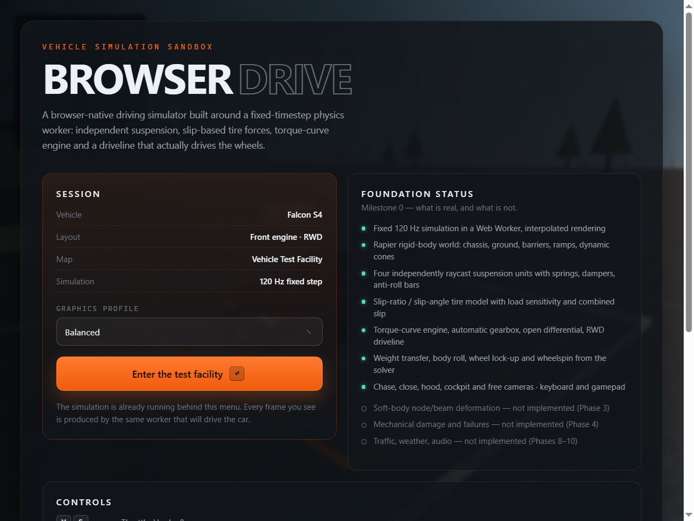

# Browser Drive

A browser-native vehicle simulation sandbox, built toward BeamNG-style depth on Chromebook-class
hardware. Runs in Chrome with no install, no account and no plugins.

**Milestone 0 (foundation) is complete.** The project is now at the point where real vehicle physics
work can proceed: a fixed-timestep simulation worker, a suspension/tire/engine/drivetrain solver and a
playable test environment are in place and verified.



## What is actually implemented

- **Fixed 120 Hz simulation in a Web Worker.** The renderer never steps physics; it interpolates
  between 60 Hz snapshots. A render hitch cannot change the physics timestep.
- **Rapier 3D (WASM) rigid-body world**: ground, barriers, ramp, crash wall, buildings and eight
  dynamic traffic cones that the car can hit and scatter.
- **Custom vehicle solver** (not Rapier's raycast-vehicle controller):
  - four independently raycast suspension units with springs, bump/rebound damping, bump stops and
    anti-roll bars,
  - slip-ratio / slip-angle tire model (Magic Formula) with load sensitivity, combined-slip friction
    ellipse and rolling resistance,
  - torque-curve engine, closed-throttle drag, rev limiter, automatic gearbox with torque cut,
    open differential and RWD driveline,
  - wheel rotational dynamics with lock-up, wheelspin and handbrake,
  - aerodynamic drag and downforce.
- **Weight transfer, body roll, pitch, wheelspin, lock-up and understeer/oversteer emerge from the
  solver** — none of it is animated or scripted.
- **Procedural sedan** with body, glazing, lights (working brake lights), mirrors, interior, steering
  wheel, seats and suspension arms that move with the simulated travel.
- **Five cameras**: chase, close chase, hood, cockpit, free orbit. Speed-sensitive FOV.
- **Keyboard and gamepad** input, pause menu, reset, HUD (speed, tach, gear, pedals, wheel contact),
  performance monitor with adaptive resolution, error reporting and persisted settings.
- **69 automated tests** covering the physics maths, vehicle format, protocol validation, snapshot
  interpolation, fixed-timestep determinism and headless solver integration.

## What is *not* implemented (do not mistake this for a finished game)

- Soft-body node/beam deformation and structural damage — Phase 3/4.
- Mechanical damage and component failures — Phase 4.
- Additional vehicles and maps; vehicle selection and garage — Phase 5/7.
- AI traffic, weather, audio — Phases 8–10.
- Clutch is a simplified lock-factor model; a true engine-inertia/clutch model is Phase 2.
- Wheelspin does not flare the tach (engine speed is derived from road speed for stability).
- Camera collision avoidance, terrain streaming and LOD are not implemented.

## Requirements

- Node.js 22+ and npm (developed on Node 26).
- Chrome (or any Chromium/WebGL 2 browser). WebGL 2 is required and detected at startup.

## Quick start

```bash
npm install        # install dependencies from package-lock.json
npm run dev        # http://localhost:3000
npm test           # 69 unit + integration tests
npm run typecheck  # tsc --noEmit
npm run build      # typecheck + production bundle into dist/
npm run preview    # serve the production build
```

The game boots to the main menu with the simulation already running behind it. Press **Enter the test
facility** (or click) and drive.

## Controls

| Action | Input |
| --- | --- |
| Throttle | `W` / `↑` |
| Brake / reverse | `S` / `↓` |
| Steer | `A` `D` / `←` `→` |
| Handbrake | `Space` |
| Shift up / down (manual boxes) | `E` / `Q` |
| Cycle camera | `C` |
| Free camera | `F` (drag to orbit, wheel to zoom) |
| Reset vehicle | `R` |
| Pause | `Esc` |

Gamepad: left stick steers, triggers are throttle/brake, `A` is handbrake, `RB`/`LB` shift.

## Architecture

```
main thread                              simulation worker
┌───────────────────────────┐            ┌──────────────────────────────┐
│ input → InputState        │  postMsg   │ fixed 120 Hz clock           │
│ Three.js renderer         │ ─────────► │ vehicle solver (TS)          │
│ camera rig + HUD + menus  │            │ Rapier world (WASM)          │
│ snapshot interpolation    │ ◄───────── │ 60 Hz snapshots + timings    │
└───────────────────────────┘            └──────────────────────────────┘
```

- `src/sim/` — simulation only. No Three.js imports; deterministic plain maths (`math3.ts`).
- `src/render/` — Three.js scene, camera, procedural facilities and vehicle model.
- `src/app/` — application lifecycle, worker wiring, interpolation, settings, errors.
- `data/vehicles/*.ts` — vehicle definitions (mass, geometry, engine, box, tires, brakes, aero).
- `data/maps/*.ts` — map definitions used by **both** the renderer and the physics colliders.
- `docs/` — architecture, physics model, vehicle format and asset licensing.

Quality profiles (`performance` / `balanced` / `high`) change rendering only: resolution, shadows,
anisotropy and scenery density. **Simulation accuracy never changes with graphics settings.**
Adaptive resolution additionally lowers the framebuffer scale on slow GPUs, never the physics rate.

## Measured performance (from the verification run)

Measured in the cloud browser session (virtualised AMD Radeon 610M via ANGLE/D3D11, 1280×800):

| Metric | Value |
| --- | --- |
| Simulation step (120 Hz) | **0.05–0.14 ms** |
| Simulation bodies | 9 + 4 wheels + static world |
| Snapshot age on main thread | 4–6 ms |
| Draw calls | ~250 |
| Triangles | ~16k |
| Adaptive render scale reached | 0.40× |
| Frame rate | **~13 FPS in that VM** |

The simulation budget is tiny. The frame rate is limited by per-draw-call overhead on this VM's
virtualised GPU (disabling the vehicle moved it to ~60 FPS, disabling shadows only +2 FPS). **This is
not a Chromebook measurement and is not representative of real GPU hardware.** Reducing draw calls
(merged static geometry, instanced wheels) and profiling on actual Chromebook hardware is tracked as
performance work, not claimed as done.

## Testing

`npm test` runs:

- **Unit**: torque curve, power, engine braking, rev limiter; tire peak/saturation/load sensitivity;
  suspension springs, dampers, bump stops, anti-roll; gear selection, reverse, manual box; fixed-step
  clock determinism and backlog handling; message validation and input clamping; snapshot interpolation.
- **Integration** (`tests/vehicle-simulation.test.ts`): runs the real solver against the real world in
  Node with the Rapier WASM loaded from bytes. Verifies the car settles on its springs, stays parked at
  idle, accelerates past 40 km/h under throttle, brakes to a stop, transfers load to outside wheels in a
  turn, locks the rear wheels on the handbrake, and resets cleanly.

The production build is checked with `npm run build`. Browser verification was performed in Chrome:
the app boots with no console errors, the worker reaches ready, the car sits at 0.09 km/h at idle, and
holding `W` reached ~51 km/h with four wheels grounded before braking back to 0.1 km/h.

## Repository layout

```
index.html            UI shell (menu, HUD, perf monitor, pause, errors)
src/main.ts           bootstrap
src/app/              game loop, settings, snapshot buffer, error plumbing
src/sim/              worker, world, vehicle solver and physics modules
src/render/           renderer, camera rig, facility, procedural vehicle
src/ui/               HUD and menu controllers
src/input/            keyboard/gamepad handling and smoothing
src/save/             IndexedDB settings store (localStorage fallback)
data/                 vehicle and map definitions
tests/                Vitest unit and integration tests
docs/                 architecture, physics, vehicle format, licences
```

## Next milestone

Phase 1/2 focus: replace the simplified clutch with an engine-inertia + clutch model, add a limiter
flare, per-wheel differential behaviour (LSD/locking), surface-dependent friction from the map data,
and a longitudinal/lateral dynamics regression suite. Phase 3 (node/beam soft body) starts only after
the handling model is trustworthy.

## Licence / assets

All geometry, textures and sounds in this repository are original and generated in code; no
third-party art assets are included. Library licences are listed in [docs/asset-licenses.md](docs/asset-licenses.md).
