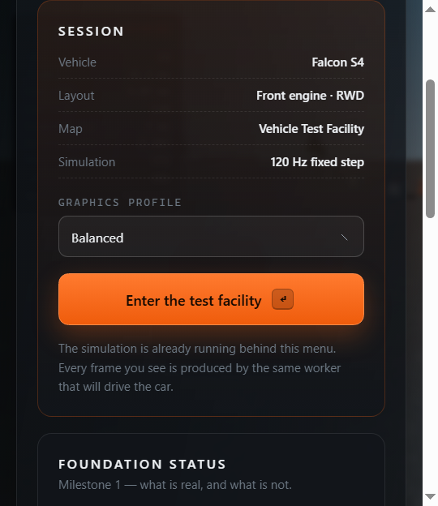
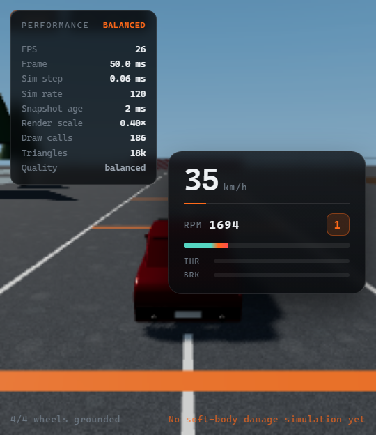

# Browser Drive

A browser-native vehicle simulation sandbox, built for Chromebook-class hardware. Runs in Chrome with
no install, no account and no plugins.

**Milestone 1 (advanced vehicle dynamics) is complete.** The vehicle now has its own powertrain state:
a rotating engine, a slipping clutch, selectable differentials and surface-dependent tire physics, all
driven at a fixed 120 Hz in a Web Worker and validated by 128 automated tests.




## What is implemented

### Simulation core

- **Fixed 120 Hz simulation in a Web Worker**, rendered by interpolating 60 Hz snapshots. The render
  loop cannot change the physics timestep.
- **Rapier 3D (WASM) rigid bodies** for the chassis, world and dynamic props. Rapier is not the vehicle
  model.
- **Four independently raycast suspension units** with springs, bump/rebound damping, bump stops and
  anti-roll bars.
- **Slip-based Magic Formula tires** with load sensitivity, a combined-slip friction ellipse and
  rolling resistance.
- **Surface-dependent friction**: ten surface materials (dry/wet asphalt, concrete, gravel, dirt, mud,
  grass, sand, snow, ice) feed separate longitudinal and lateral grip plus rolling resistance into the
  tire solver at each contact patch, with grip blended across boundaries.
- **Engine rotational dynamics**: crankshaft inertia, torque curve, friction and pumping losses, idle
  governor, rev limiter with hysteresis, stalling and starter-motor restart.
- **Slipping clutch**: Coulomb capacity with a smooth slip curve, launch capacity modulation and
  torque-interrupted shifts. Engine speed is independent of wheel speed and coupled only through the
  clutch, so wheelspin flares the engine and heavy loads drop it.
- **Gearbox**: automatic and manual modes, torque cut during shifts, anti-hunt hold, drive-speed and
  road-speed shift scheduling, reverse engagement.
- **Differentials**: open, viscous, clutch-type limited slip, geared limited slip and locking, with
  configurable preload, bias, locking strength and maximum transfer. RWD, FWD and AWD with an optional
  centre coupling.
- **Aerodynamic drag and downforce**, weight transfer, body roll and pitch — all emergent.

### Application

- Professional menu with honest status, pause menu, HUD (speed, tach, gear, pedals, wheel contact),
  performance monitor with adaptive resolution, error reporting and persisted settings.
- Five cameras (chase, close, hood, cockpit, free orbit), speed-sensitive FOV.
- Keyboard and gamepad input.
- Procedural sedan and facility (no third-party art), with a second AWD vehicle definition that reuses
  the same chassis, engine, gearbox and suspension components.
- Test facility with acceleration strip, skid pad, slalom, ramp, articulation bumps, crash wall,
  surface test fields and a split-friction lane.

## What is *not* implemented

- Soft-body node/beam deformation and structural damage — Phases 3–4.
- Mechanical damage, failures and persistent damage — Phase 4.
- ABS/ESP, traction control, wet-weather tire dynamics beyond grip scaling.
- Clutch wear/temperature, torque converter hydraulics, gearbox inertia and backlash.
- Additional vehicles/maps, garage, traffic, weather, audio.
- Camera collision avoidance, terrain streaming, LOD.
- The vehicle and facility are procedural foundation assets, not final art.

## Requirements

- Node.js 22+ and npm (developed on Node 26).
- Chrome or any Chromium/WebGL 2 browser. WebGL 2 is required and detected at startup.

## Quick start

```bash
npm install        # install dependencies from package-lock.json
npm run dev        # http://localhost:3000
npm test           # 128 unit + integration tests
npm run typecheck  # tsc --noEmit
npm run build      # typecheck + production bundle into dist/
npm run preview    # serve the production build
```

## Controls

| Action | Input |
| --- | --- |
| Throttle | `W` / `↑` |
| Brake / reverse | `S` / `↓` |
| Steer | `A` `D` / `←` `→` |
| Handbrake | `Space` |
| Shift up / down (manual) | `E` / `Q` |
| Cycle camera | `C` |
| Free camera | `F` (drag to orbit, wheel to zoom) |
| Reset vehicle | `R` |
| Pause | `Esc` |

Gamepad: left stick steers, triggers are throttle/brake, `A` is handbrake, `RB`/`LB` shift.

## Architecture

```
main thread                              simulation worker
┌───────────────────────────┐            ┌──────────────────────────────┐
│ input → InputState        │  postMsg   │ fixed 120 Hz clock           │
│ Three.js renderer         │ ─────────► │ engine → clutch → gearbox    │
│ camera rig + HUD + menus  │            │ differentials → tires        │
│ snapshot interpolation    │ ◄───────── │ Rapier world + surfaces      │
└───────────────────────────┘            └──────────────────────────────┘
```

- `src/sim/` — simulation only, no Three.js imports.
  - `vehicle/engine.ts` engine rotational state, idle governor, stall/restart.
  - `vehicle/clutch.ts` clutch capacity, slip torque and engagement logic.
  - `vehicle/differential.ts` open/viscous/LSD/locking torque distribution.
  - `vehicle/tire.ts` surface-aware Magic Formula.
  - `surfaces.ts` the surface material catalogue.
- `src/render/` — Three.js scene, procedural facility and vehicle model, merged static geometry.
- `src/app/` — lifecycle, worker wiring, interpolation, settings, errors.
- `data/components/` — reusable engine, gearbox, clutch, differential, tire, suspension and chassis
  definitions.
- `data/vehicles/*.ts` — vehicle definitions composed from components.
- `data/maps/*.ts` — map geometry, surface patches and spawns used by both rendering and physics.

Graphics quality (`performance` / `balanced` / `high`) changes resolution, shadows, anisotropy and
scenery density only. **Simulation fidelity never changes with graphics settings.**

## Measured performance (verification run)

Cloud browser VM (virtualised AMD Radeon 610M via ANGLE/D3D11), 1280×800, balanced profile:

| Metric | Milestone 0 | Milestone 1 |
| --- | --- | --- |
| Simulation step | 0.05–0.14 ms | **0.06–0.11 ms** |
| Draw calls (menu / driving) | 249 / 246–295 | **186–196 / 210–215** |
| Frame rate | 13–15 FPS | **20–26 FPS** |
| Render scale | 0.40× | 0.40× |
| Triangles | ~16k | ~19k (more surfaces) |

Draw calls fell by merging static facility geometry per material, instancing the cones and merging each
wheel's spokes. The frame rate improved ~60% at the same resolution. **This is a virtualised GPU, not a
Chromebook measurement**; real Chromebook profiling remains outstanding.

## Testing

`npm test` runs 128 tests in 15 files:

- **Unit**: torque curve and limiter; engine inertia, idle governor, stall and restart; clutch
  capacity, slip saturation, launch modulation and engagement; differential splitting for all five
  types; surface grip ordering and surface-scaled tire forces; suspension springs/dampers/anti-roll;
  transmission shifting, hysteresis and reverse; message validation; fixed-step clock; snapshot
  interpolation.
- **Integration** (headless Rapier in Node): parking, acceleration, braking, handbrake lock, weight
  transfer, reset.
- **Handling regression** (`tests/handling.test.ts`): launch with wheelspin and rpm flare, automatic
  upshift with rpm drop, dry-vs-ice braking from an identical 50 km/h entry, split-friction LSD and
  locking-differential behaviour, AWD acceleration, cornering lateral acceleration and load transfer,
  articulation bumps and settlement, 20 seconds of mixed input with bounded speeds/slips, and a clean
  powertrain reset.

Browser verification: the app boots with no console errors, the worker reports ready, the car sits at
0.08 km/h at idle, and full throttle reached 53.8 km/h in 4 s in 2nd gear with four wheels grounded
(engine 3793 rpm, simulation step 0.11 ms).

## Repository layout

```
index.html            UI shell (menu, HUD, perf monitor, pause, errors)
src/main.ts           bootstrap
src/app/              game loop, settings, snapshot buffer, error plumbing
src/sim/              worker, world, surfaces, vehicle solver and powertrain modules
src/render/           renderer, camera rig, facility, procedural vehicle, geometry merging
src/ui/               HUD and menu controllers
src/input/            keyboard/gamepad handling and smoothing
src/save/             IndexedDB settings store (localStorage fallback)
data/components/      reusable vehicle components
data/vehicles/        vehicle definitions
data/maps/            facility definition incl. surface patches
tests/                Vitest unit, integration and handling tests
docs/                 architecture, physics, vehicle format, licences
```

## Next milestone

Milestone 2 (vehicle structural simulation): node/beam structures, constraints, deformation and
breakage — only now that the handling foundation is stable and tested.

## Licence / assets

All geometry, textures and sounds are original and generated in code; no third-party art assets are
included. Library licences are listed in [docs/asset-licenses.md](docs/asset-licenses.md).
